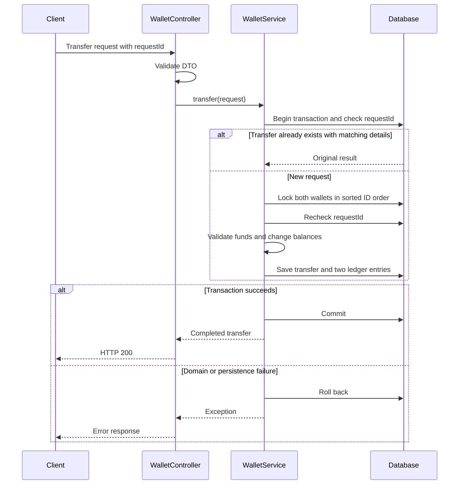

# Architecture — milestone 1

One Spring Boot process owns wallets, completed transfers and the ledger in one database. These writes must commit atomically, so they remain in a single service and transaction boundary at this stage.

## Data relationships

- `wallets`: current balance and owner label. The owner label is not yet an authenticated user identity.
- `transfers`: completed transfers, keyed by client request ID. Source and destination are foreign keys to wallets.
- `ledger_entries`: append-only through the application API. Shared `journal_id` groups the two sides of one movement. A funding-side entry has no wallet ID and uses the `SIMULATED_FUNDING` account.

No money-changing action runs outside the service transaction. HTTP validation handles input format; domain logic handles wallet existence, same-wallet transfers, sufficient funds and idempotency conflicts. Schema constraints supply additional protection.

## Failure boundaries

A successful database commit can precede an HTTP response failure. Retrying the same request ID retrieves the committed result. A lock conflict can be retried with that same ID. Concurrent misuse of one ID for disjoint wallet pairs can surface as a database uniqueness conflict; the failed transaction rolls back, and a retry resolves the stored result or returns an idempotency conflict.

Ledger balance and current balance are updated atomically, but a later reconciliation read must choose a consistent snapshot. Authentication, external funding providers, notifications and distributed workflows are future boundaries, not implemented features.
